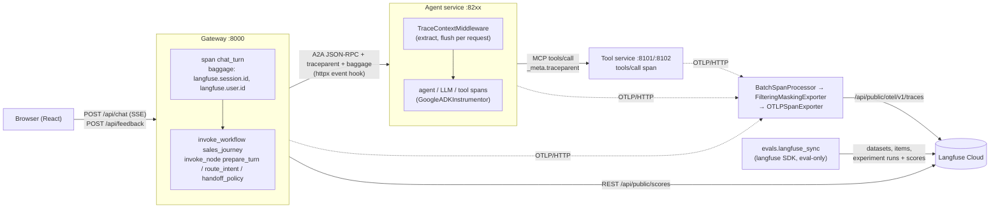

# Design: Langfuse Agent Observability

## Context

- **Topology:** the gateway (`SuperAgent`, FastAPI + ADK Workflow `sales_journey`) calls one of 10 agent services per turn over A2A (`RemoteA2aAgent`, JSON-RPC over httpx), plus up to two handoffs. Agents call the catalog and serviceability tool services over MCP (streamable HTTP, `McpToolset`).
- **Shared factories:** every agent is built through `sales_common.a2a_server.create_a2a_app`. Every gateway→agent client comes from `sales_common.a2a_client.remote_agent`, and every MCP toolset from `sales_common.mcp_client.mcp_toolset`.
- **Current telemetry state:**
  - ADK 2.10 creates OpenTelemetry spans (`google.adk.telemetry.tracing`), but no process sets a `TracerProvider`. They are dropped.
  - ADK's native LLM spans carry request and response as `gcp.vertex.agent.llm_request` / `llm_response` JSON attributes, which Langfuse does not map to observation input and output.
  - mcp 2.2 already propagates W3C trace context in JSON-RPC `_meta` (`mcp.shared._otel.inject_trace_context`, SEP-414), and its server installs `mcp.server._otel.OpenTelemetryMiddleware` by default.
  - Nothing propagates trace context over A2A.
- **Installed packages:** `opentelemetry-api/sdk 1.42.1` and the gRPC OTLP exporter (pulled in by ADK). The HTTP OTLP exporter is not installed. Langfuse accepts only OTLP over HTTP.
- **Hosting decision:** Langfuse Cloud for local and GCP. Self-hosted Langfuse v4 needs Postgres plus ClickHouse, Redis/Valkey (queue and cache) and blob storage, and v2 (Postgres-only) is end of life. Nothing new runs on our side.

## Goals / Non-Goals

**Goals:**
- One Langfuse trace per chat turn across gateway, agent and tool service, grouped into a session per conversation.
- Agent, generation and tool observations with input, output, model and tokens; workflow nodes visible.
- No per-agent code. Off by default and offline in tests.
- Payment data masked before it leaves the process.
- User feedback and golden-eval results recorded as Langfuse scores.

**Non-Goals:** self-hosting, metrics/logs export, sampling, prompt management, Langfuse-hosted evaluators, automated model-price setup.

## Topology

## Decisions

### D1. Plain OpenTelemetry pipeline plus a small REST client, not the Langfuse Python SDK

`sales_common.telemetry` builds the pipeline directly:
- `opentelemetry.sdk.trace.TracerProvider`
- `opentelemetry.sdk.trace.export.BatchSpanProcessor`
- `opentelemetry.exporter.otlp.proto.http.trace_exporter.OTLPSpanExporter`

`sales_common.langfuse_api` calls the one Langfuse public REST endpoint the services need, `POST /api/public/scores`, with httpx. Its body is a JSON array of `CreateScoreRequest` objects, and the response is 202 or 207.

*Why not the Langfuse SDK:*
- v5 installs a default span filter that keeps only `gen_ai.*`/known-LLM-scope spans and would drop our workflow and HTTP-level structure unless replaced.
- It owns its own provider, while the MCP SDK and ADK need the global provider.
- Its cross-service baggage handling isn't documented for the receiving side.

A single provider whose processors we own lets masking, filtering and attribute stamping apply uniformly to every span source. The services need only one REST endpoint (scores).

The eval sync is the exception (D9). It is a standalone offline process with no ADK or MCP spans, so it uses the SDK.

### D2. OpenInference ADK instrumentation for span content

`openinference.instrumentation.google_adk.GoogleADKInstrumentor().instrument()` (package `openinference-instrumentation-google-adk`, 1.1.x, which requires `google-adk>=2.10.0`) is the integration Langfuse documents for ADK.
- It wraps `Runner.run_async`, `BaseAgent.run_async` and `NodeRunner._execute_node`, and records `input.value`/`output.value`, `openinference.span.kind` (AGENT, LLM, TOOL, CHAIN), `llm.model_name` and `llm.token_count.*`. Langfuse maps all of these.
- It replaces ADK's module tracers with selective proxies (`_disable_existing_tracers`), so ADK-native `call_llm`/`invoke_agent` spans are not duplicated. `invoke_workflow`/`invoke_node` spans keep their names and gain node input and output.

*Alternative:* ADK-native spans only. Rejected because their input and output live in `gcp.vertex.agent.*` attributes that Langfuse shows only as raw metadata.

### D3. Trace propagation

| Hop | Mechanism | API |
|---|---|---|
| Gateway → agent (A2A) | httpx request event hook on the client built in `remote_agent()` | `opentelemetry.propagate.inject(request.headers)` |
| Agent receives A2A | pure ASGI middleware wrapping the app returned by `google.adk.a2a.utils.agent_to_a2a.to_a2a` | `opentelemetry.propagate.extract`, `opentelemetry.context.attach/detach` |
| Agent → tool (MCP) | built into mcp 2.2 | client `mcp.shared._otel.inject_trace_context` into `_meta`; server `mcp.server._otel.OpenTelemetryMiddleware` (on by default) |

a2a-sdk's `DefaultRequestHandler` starts the agent run with `asyncio.create_task` while handling the request, so the attached context is copied into the task and ADK spans parent to the gateway's span.

*Alternatives:*
- `opentelemetry-instrumentation-httpx` globally. Rejected: it adds a dependency and also wraps google-genai's httpx calls.
- `opentelemetry-instrumentation-asgi`/`starlette`. Rejected: it adds server spans per HTTP request, which is noise against the quota, and another dependency.
- Using `header_provider` in `McpToolset`. Rejected: it isn't needed, and changing headers per call would churn ADK's pooled MCP sessions.

The default global propagator (`tracecontext,baggage`) is used.

### D4. Session, user, environment and release stamped by a SpanProcessor

The gateway's `chat_turn` span sets OTel baggage `langfuse.session.id` (gateway session id) and `langfuse.user.id` (`user:customer_id` from gateway state, else the gateway session's user id), using `opentelemetry.baggage.set_baggage`. `LangfuseAttributesProcessor.on_start` copies these two baggage entries onto every span in every service, and adds `langfuse.environment` (`LANGFUSE_TRACING_ENVIRONMENT`) and `langfuse.release` (`LANGFUSE_RELEASE`).

The `langfuse.*` keys take precedence in Langfuse over the `session.id`/`user.id` that OpenInference sets from each runner's local ids. That matters because an agent's runner user id is the A2A user, not the customer.

Only these two identifiers go into baggage, and baggage is sent only to our own services (the A2A client hook and MCP `_meta`), never to Gemini.

### D5. Masking and filtering in an exporter wrapper

`FilteringMaskingExporter(SpanExporter)` wraps the OTLP exporter. Spans are read-only in `SpanProcessor.on_end`, so the wrapper rebuilds each `ReadableSpan` with masked attributes before export. It:
1. drops MCP protocol spans: every `mcp.method.name` except `tools/call`, `resources/read` and `prompts/get`, so `initialize`, `server/discover` (the newer handshake), `tools/list`, `ping` and `notifications/*` are all dropped
2. masks card numbers (Luhn-checked), CVV and account/routing numbers in string attributes
3. with `LANGFUSE_CAPTURE_CONTENT=false`, removes the content attributes `input.value`, `output.value`, `llm.input_messages.*`, `llm.output_messages.*`, `gcp.vertex.agent.llm_request`/`llm_response`/`tool_call_args`/`tool_response`, `langfuse.observation.input`/`output` and `gen_ai.*.messages`

Event attributes (exceptions) are masked too.

*Alternative:* masking in the Langfuse SDK (`mask=`). Not applicable given D1.

### D6. Delivery on Cloud Run: flush per request

Cloud Run throttles CPU after the response completes, which stalls `BatchSpanProcessor`'s export thread until the next request or SIGTERM. With `TELEMETRY_FLUSH_PER_REQUEST=true`, which `deploy_cloud.sh` sets, `TraceContextMiddleware` intercepts the final `http.response.body` message (`more_body` false). It then runs `provider.force_flush(TELEMETRY_FLUSH_TIMEOUT_MS)` in a worker thread (`asyncio.to_thread`) before sending that message. Lifespan shutdown calls `shutdown_telemetry()`.

*Alternative:* `--no-cpu-throttling`. Rejected: it bills idle instance time across 13 services.

*Cost:* one export round trip (tens to low hundreds of ms) at the end of each request on Cloud Run. Local default is off.

`force_flush(timeout)` does not interrupt an export that is retrying. In a smoke test with Langfuse unreachable, a 1.5 s flush took 6.2 s. So with per-request flushing, the OTLP exporter's own `timeout` (retries included) is capped at the flush budget (`export_timeout_seconds`), and an outage adds at most about `TELEMETRY_FLUSH_TIMEOUT_MS` per request. Without per-request flushing it stays 10 s, in the background thread.

### D7. Root span per turn in the gateway; `trace_id` in `done`

`stream_turn` (`SuperAgent/server/api/chat.py`) opens `chat_turn` with `tracer.start_as_current_span` around the retry loop (with the baggage context attached). It sets:
- `langfuse.trace.name`
- `langfuse.observation.input`/`output`
- `langfuse.trace.tags` (answering agents, `handoff`, `error`)
- `langfuse.trace.metadata.*` (hops, attempts)

The trace id is `format(span_context.trace_id, "032x")`. The suggestions call (`google.genai.Client.models.generate_content`, outside ADK) gets a manual span with `openinference.span.kind=LLM`, `llm.model_name`, `input.value`/`output.value` and `llm.token_count.prompt/completion/total` from `usage_metadata`. `asyncio.to_thread` copies the context.

### D8. Feedback authorization: signed token, no server state

`feedback_token = URLSafeSerializer(SESSION_SECRET_KEY, salt="csa-feedback").dumps([session_id, trace_id])` (`itsdangerous`, already a gateway dependency). `/api/feedback` loads it and requires the session id to equal the bearer session and the trace id to equal the body's `trace_id`. This works across Cloud Run instances without storage.

The score is created with `id = sha256("user_feedback:" + trace_id)[:32]`, so a revote overwrites it (Langfuse upserts scores by id).

### D9. Evals: uniform `cases.jsonl` and a separate sync step

- Each tier appends one JSON line per scored case to `evals/results/<ts>/cases.jsonl`: router in `test_router.py`, agents in `agent_runner.py`/`test_agents.py`, journeys in `test_journeys.py`. Journeys also record per-turn `trace_id`s from `done` and the gateway session id (`X-Session-Id`).
- `python -m evals.langfuse_sync <dir>` uses the official `langfuse` Python SDK (5.x). It runs in an **isolated environment** (`uv run --no-project --with-requirements evals/requirements-langfuse.txt`, or `.venv-langfuse` without uv), because langfuse 5.x requires `opentelemetry>=1.45` while google-adk 2.10 pins `<=1.42.1`. langfuse 4.15.6, the last release that accepts OTel 1.42, still links runs through the removed dataset-run-items endpoint. The module imports only the standard library, `evals.cases` and `langfuse`:
  1. It upserts datasets (`Langfuse.create_dataset`) and items (`create_dataset_item(id=…)`, where the id is a stable hash of the case key; dataset items upsert on id).
  2. It calls `DatasetClient.run_experiment(name=…, run_name=<results dir>, task=…, evaluators=[…], metadata={git, model})`. The task replays the recorded `actual` output for the item, so no model is re-run. Inside the task, `langfuse.propagate_attributes(session_id=<case session>)` puts journey cases in their gateway session. The evaluators return the recorded metric values as NUMERIC scores and `passed` as a BOOLEAN score.

  The SDK links each trace to the dataset run through OTel `langfuse.experiment.*` attributes, using a server-compatible experiment id. Experiment traces carry Langfuse's fixed environment `sdk-experiment`.

Separating the sync from the pytest run keeps the run's pass/fail independent of Langfuse availability. The sync can also be re-run on an existing results directory.

*Alternatives:*
- A hand-written REST sync. Rejected: the public API no longer has a dataset-run-items endpoint (verified against `cloud.langfuse.com/generated/api/openapi.yml`, 2026-11-14). Run membership is now set by span attributes whose experiment id must match a server-side hash.
- Running the SDK's experiment runner live, with the agents as the task. Rejected because it would replace the existing ADK/pytest runners and their metrics.

## Risks / Trade-offs

- **Langfuse Cloud receives customer data** (names, addresses, emails, quotes). → Payment numbers are masked. `LANGFUSE_CAPTURE_CONTENT=false` removes all content. Choose the Langfuse region with `LANGFUSE_HOST`. The data is seed/demo data today.
- **Quota.** A turn produces roughly 20–60 observations, and a full eval run produces several thousand. → MCP protocol spans are dropped, eval export is opt-in, and the quota note is documented.
- **The instrumentor patches ADK internals** (`NodeRunner._execute_node`, module tracers). An ADK upgrade can break it. → The version is pinned in `libs/sales_common/pyproject.toml`. The instrumentor logs and degrades rather than raising. Tests assert spans exist, so an upgrade shows up as a failing test.
- **Async-generator context:** `chat_turn` is attached inside an async generator. If the client disconnects and Starlette closes the generator from another context, OTel logs "Failed to detach context". → This is harmless (logged by OTel, not raised), and a test covers disconnect.
- **A2A context propagation depends on a2a-sdk creating the run task inside the request.** → Verified by an integration test that asserts the agent's span shares the gateway's trace id. If an a2a-sdk upgrade breaks it, sessions still group because every span carries `langfuse.session.id` from baggage. Without baggage, the agent's runner session id equals the gateway session id (`forward_session_id_as_context_id=True`).
- **Per-request flush latency on Cloud Run.** → Bounded by `TELEMETRY_FLUSH_TIMEOUT_MS` (2000 ms default). Export failures are logged, not raised.

## Migration Plan

1. Merge with keys unset: no behavior change. `done` is unchanged and the UI shows no feedback controls.
2. Locally: create a Langfuse Cloud project, put the keys in `.env`, and restart.
3. GCP: re-run `scripts/setup_gcp.sh` (it prompts for the Langfuse secrets), then `scripts/deploy_cloud.sh`.
4. Rollback: unset the keys (locally) or delete the secrets and redeploy (GCP). Tracing turns off with no data migration.

## Open Questions

- Does Langfuse Cloud price `gemini-3-flash-preview` out of the box? If not, add a custom model definition in the project settings (documented step).
