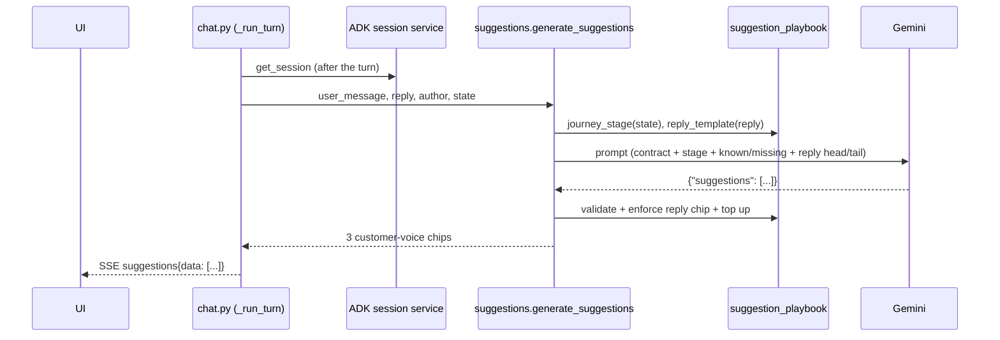

# Design: Customer-Voice Suggested Next Steps

## Flow

APIs used:
- `google.genai.Client().models.generate_content` (unchanged call)
- `runner.session_service.get_session(app_name=, user_id=, session_id=)` (`google.adk.sessions.BaseSessionService`) to read the post-turn state
- `super_agent.workflow.journey_flags` for the shared flag derivation

## Stages

`journey_stage(state)` is evaluated top-down, and the first match wins:

| Stage | Condition |
|---|---|
| `provisioning` | payment status in `PAYMENT_DONE_STATUSES` |
| `payment` | order created and installation scheduled |
| `schedule` | order created |
| `quote` | `offer_context.offer_id` |
| `not_serviceable` | serviceability checked and `is_serviceable` is false |
| `products` | serviceable |
| `address` | customer identified (no serviceability yet) |
| `new` | otherwise |

This order matches the gateway's real flow: order, then installation appointment (fulfillment), then payment (handoff), then provisioning. The SSE mapper's `provisioning_done` flag still forces `provisioning`.

## Reply templates

`reply_template(reply)` inspects the tail of the agent reply (the last 400 characters). If the tail contains a question or a request ("please provide", "could you", "what is", "let me know"), the first matching topic wins:

| Topic cue | Template |
|---|---|
| card / payment details / CVV | `My card is [card number], exp [MM/YY], CVV [CVV]` |
| email / phone / contact | `You can reach me at [email] or [phone]` |
| date / time / appointment / schedule | `[date] in the [morning/afternoon] works for me` |
| address / ZIP / location | `Our address is [street, city, state ZIP]` |
| company / business name | `We're [company name], located at [street, city, state ZIP]` |
| needs / employees / speed / use | `We have [number] employees and need [internet/voice/...]` |
| add anything else / any other products | `No, that's everything. Let's proceed` |
| confirm / proceed / would you like | `Yes, let's go ahead` |

## Validator

A chip is rejected if it:
- is empty or a duplicate
- is longer than 80 characters
- addresses the customer (`\byour (company|business|address|location|name|email|phone|employees|needs)\b`, `tell me about your`)
- mentions `the customer`
- is filler (`continue`, `next`, `ok`, `summary`, `show me next best step`)

If the agent asked something and no surviving chip has a placeholder or starts as a reply, the reply template is prepended. The list is then filled up to 3 from `PLAYBOOK[stage]`, skipping duplicates. If the LLM fails or is unparseable, the result is the reply template (when present) followed by the playbook. When suggestions are enabled, the server therefore always sends 3 chips.

## UI placeholders

`findPlaceholder(text, from)` returns `{start, end}` of the next `[...]` at or after `from`, wrapping to the start of the text, or `null`.

In `ChatInput`:
- **pre-fill:** set the text, then select the first placeholder (or move the cursor to the end).
- **Tab or Enter with a placeholder remaining:** prevent the default and select the next one.
- **Send:** blocked while `hasPlaceholder(text)`; a hint "Fill in the [highlighted] parts" is shown.
