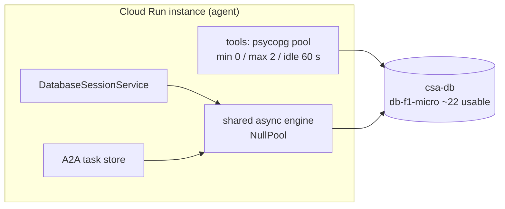

# Design: Database Connection Budget

## Connections per instance

Before: up to 5 + 15 + 15 = 35 connections per agent instance, with at least 1 always held, plus pooled idle connections.
After: up to 2 tool connections, plus one asyncpg connection per in-flight session or task query; nothing is held while idle.

A turn runs about one agent at a time, plus the gateway. Peak use is then a few connections per active service, which fits the budget.

## APIs

- `google.adk.sessions.DatabaseSessionService(db_engine=AsyncEngine)`: when it is given an engine, it does not own or dispose it.
- `sqlalchemy.ext.asyncio.create_async_engine(url, poolclass=sqlalchemy.pool.NullPool)`.
- `psycopg_pool.ConnectionPool(min_size=0, max_size=2, max_idle=60)`.

## Configuration

| Variable | Default | Effect |
|---|---|---|
| `DB_ASYNC_POOL_SIZE` | `0` | `0` = NullPool; `n` = QueuePool of size `n` |
| `DB_ASYNC_MAX_OVERFLOW` | `0` | QueuePool overflow when the size is > 0 |
| `DB_POOL_MIN` | `0` | psycopg pool minimum |
| `DB_POOL_MAX` | `2` | psycopg pool maximum (was 5) |
| `DB_POOL_MAX_IDLE_S` | `60` | psycopg idle connection lifetime |

NullPool opens a connection per query. Over the Cloud SQL unix socket that costs a few milliseconds. A deployment with a larger database can opt back into pooling with `DB_ASYNC_POOL_SIZE`.
