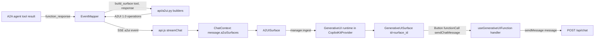

# Design: A2UI Generative Cards in the Sales Chat

## Context

The gateway (`SuperAgent/server/api/sse.py` `EventMapper`) already sees every remote tool result (`function_response` crosses the A2A boundary) and turns some of them into `activity_update`, `structured_card` and `cart_update` events. The React client (Vite, not Next.js) renders assistant messages in `MessageBubble.jsx`. CopilotKit 1.85 provides A2UI 1.0 rendering in `@copilotkit/react-core/v2/generative-ui`.

## Topology

## Decisions

1. **Deterministic A2UI from tool results, not from the LLM.** Project rule: deterministic business data comes from tools, never from generation. Builders are pure functions of the tool response, so prices, speeds and coverage are exactly what the tools returned. No prompt or routing change, so no golden re-record.
2. **Additive SSE event.** `{"type": "a2ui", "surface_id", "tool", "author", "operations": [A2UIOperation]}`. `structured_card` and `cart_update` are unchanged, so older clients keep working. `surface_id` is `<tool>-<sha256(response)[:12]>`, stable for the same result, unique per distinct result. Operations use A2UI `version: "1.0"` and one `createSurface` carrying `components` (root id `root`) and `dataModel`; no `catalogId` (the renderer fills in the provider UI's id).
3. **MCP results are unwrapped** with `sales_common.mcp_client.mcp_result_payload` (structuredContent → JSON text), as `serviceability_agent/callbacks.py` does. Function-tool results (quotes) are plain dicts.
4. **Actions as a client function.** In CopilotKit, `{event}` bindings are forwarded to a CopilotKit agent, which this app does not have. Buttons therefore bind `action: {functionCall: {"@call": "sendChatMessage", "args": {"message": "…"}}}`. `salesUI = createGenerativeUI({ id: "connectivitymax/sales@1", extends: [standardUI], functions: { sendChatMessage } })` declares it; `useGenerativeUIFunction(salesUI, "sendChatMessage", …)` (mounted once, in `ChatProvider`'s subtree) calls the chat's `sendMessage`. Messages are customer-voice ("Accept this quote and place my order"), so a click reads in the transcript like a typed reply and routes normally.
5. **Rendering without a CopilotKit runtime.** `CopilotKitProvider` requires `runtimeUrl`, a public key or local agents (it throws in production without one). The client registers one inert local agent (`InertAgent extends AbstractAgent` from `@ag-ui/client`, whose `run` completes immediately) via `agents__unsafe_dev_only`; it holds no keys and is never run because no CopilotKit chat is mounted. (`selfManagedAgents` is avoided: CopilotKit marks it as a paid tier.) `A2UISurface` calls `useGenerativeUIRuntime().manager.ingest(THREAD_ID, undefined, {surfaceId, target: surfaceId, operations, status: "ready", rejected: []})` in a layout effect (after `manager.setActiveThread(THREAD_ID)`) and renders `<GenerativeUISurface id={surfaceId} ui={salesUI} autoScroll={false} />`. One target per surface keeps every message's surface in place.
6. **Theme.** `src/a2ui/theme.js` maps `--a2ui-*` variables to the Tailwind palette (primary blue, slate text, rounded corners) and is passed as `generativeUI.theme`; the stylesheet is `@copilotkit/react-core/v2/styles.css`. No inline styles in app components.
7. **Legacy cards.** When `message.a2uiSurfaces` has a surface of kind quote/serviceability/products, `MessageBubble` renders the reply text plus the surfaces and skips the matching legacy card. Without one (e.g. text-only replies), the legacy parsers run as before.
8. **Catalog contract.** `SuperAgent/client/scripts/export_a2ui_catalog.mjs` (`npm run export:a2ui-catalog`) writes `exportA2UICatalog(salesUI)` to `SuperAgent/server/a2ui/catalog.json`. `test_a2ui.py` checks every component a builder emits exists in it and every required prop is present, so a CopilotKit upgrade that renames a component fails in CI, not in the browser.

## Surfaces

- **Quote:** Card → Column: title "Your quote" + offer id; Table of items (product, qty, monthly price); totals (monthly, discount, term, total); Row of Buttons "Accept this quote and place my order", "Email me this quote". Hidden when `success` is false.
- **Serviceability:** Card: "Service available at <address>" or "Not available at <address>"; technology, max speed, install lead time, product categories; Button "Show me the plans available at my address" (serviceable) or "What other options do I have?" (not).
- **Products:** Card: Table of name/technology/download/upload (no prices: product_agent never prices); per product (≤5) Button "Tell me more about <name>"; plus "Get me a quote for <name>" for the first. Compare: Table rows = attributes, columns = products; "Get me a quote for <fastest>".

## Risks

- CopilotKit generative UI is marked experimental; pinned exact versions and the catalog contract test limit drift.
- `agents__unsafe_dev_only` is named for browser-side agents with secrets; the inert agent has none. If CopilotKit removes it, a stub `runtimeUrl` endpoint on the gateway is the fallback.
