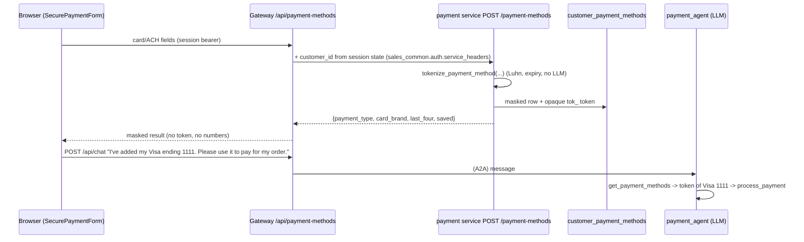

# Design: Guided Checkout

## Secure payment entry

- The REST route lives in the payment service (it owns `customer_payment_methods`), added through a new `extra_routes` argument of `sales_common.a2a_server.create_a2a_app`. It calls `payment_agent.tools.payment_tools.tokenize_payment_method` directly (plain function, `tool_context=None`, explicit `customer_id`). The response omits the token.
- The gateway never logs the request body and rejects it when the session has no `customer_context.customer_id` (409). Cloud Run: service-to-service ID token from `service_headers`, like A2A calls.
- `SecurePaymentForm` is a custom component in `salesUI` (`createGenerativeUI({ extends: [standardUI], components: { SecurePaymentForm } })`). Its props are `amount` (string) and `methods` (`card`, `ach`). Card fields live in `useState`, not in the A2UI data model (the generative UI runtime can summarize data models for a model; ours never runs one, but the form keeps them out regardless). Inputs use `autocomplete="cc-number"` etc., the CVV is `type=password`, and fields are cleared after submit. Tailwind only.
- Chat masking: `chat.py` runs `sales_common.telemetry.mask_text` on the user message before the workflow sees it. When something was masked, the stored and forwarded message carries the placeholders, and the payment prompt tells the customer to use the secure form.
- Safety: the reproduction showed false positives at LOW (HARASSMENT MEDIUM, SEXUALLY_EXPLICIT LOW for a payment prompt). Default thresholds become `BLOCK_MEDIUM_AND_ABOVE`; with the rewritten prompt all categories were NEGLIGIBLE.

## Scheduling handoff

`ContextBridgePlugin` sets `order_created_order = <order_id>` when `create_order` succeeds. `evaluate_handoff`: `last_agent == order_agent` and `order_created_order` set and the order has no scheduled installation (`order_context.installation.status != scheduled`) → `service_fulfillment_agent` with "Order <id> was just created for <service> at <address>. Call check_availability now and ask the customer to pick one of the slots shown." (clears the flag). One hop; the existing fulfillment → payment hop happens in the later turn when the customer picks a slot.

## Surfaces (gateway, `api/a2ui.py`)

`build_surface(tool, response, state=None)`; `state` is the gateway session state at the start of the turn (passed to `EventMapper`), used for the address's `available_products` (product lists) and the order total (payment card). New surfaces:
- cart: items, monthly total; buttons "That's everything — place my order", "Add another service".
- order: order id, status, service, address, total; button "Show installation times" (only when no installation is scheduled).
- installation slots: one Row per date (weekday + date), one Button per window: "Book Thursday, Nov 27, 2026 · 8 AM–12 PM" → message "Please book my installation for Thursday, November 27, 2026, 8 AM–12 PM (morning)."; at most 10 slots.
- installation scheduled: date, window, appointment id, address.
- payment: amount due, saved methods (Button per method → "Pay for my order with my Visa ending 1111"), `SecurePaymentForm`.
- payment receipt: amount, method, transaction id, status.
- product detail: name, technology, speeds, features (no price); buttons "Get me a quote for <name>", "Compare plans".
- Numbers: `_num()` renders whole floats as integers.
- Quote buttons: "Accept quote" → "I'll take quote OFF-… (24 months). Please place my order."

## Selected quote

`sales_common.repositories.quotes.load_offer_context(offer_id, customer_id)` returns an `offer_context` for an active quote of that customer (`selected: true`). In `prepare_turn`, when the user message contains `OFF-[A-Z0-9]{10}` different from `offer_context.offer_id` and a customer is known, the gateway loads it into `offer_context` before routing, so order_agent builds the cart from the chosen quote.

## Concise replies

`sales_common.context.UI_CARDS_INSTRUCTION`, appended to `JOURNEY_CONTEXT_INSTRUCTION` (all agents): the chat shows cards for serviceability, product lists and details, quotes, cart, orders, installation slots and confirmations, payment methods and receipts; when a tool result is one of these, reply in at most two short sentences (key fact + next question), never repeat its rows, prices, slots or IDs, and never list internal network details. The payment confirmation JSON line stays (the UI parses it).

## Risks

- Prompt and handoff changes alter golden-eval expectations; not re-recorded (billed). One live journey checks the flow.
- The scheduling handoff adds one fulfillment model call to the order-creation turn (latency).
