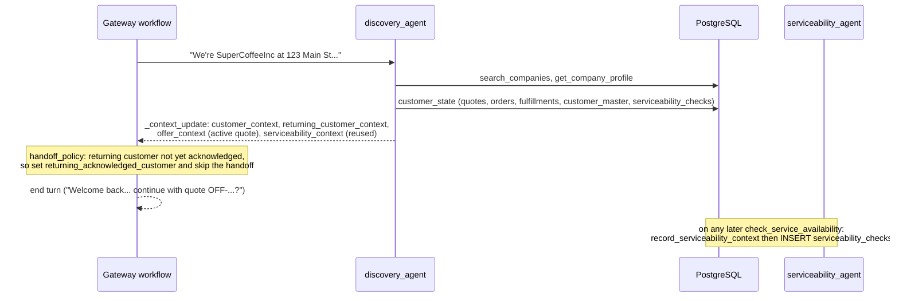

# Design: Returning-Customer Resume

## Flow



APIs:
- ADK `google.adk.plugins.base_plugin.BasePlugin.after_run_callback(*, invocation_context)` for the flush plugin
- `google.adk.tools.ToolContext.state` for state writes
- `sales_common.context.export_context_delta` exports the new journey key unchanged (JOURNEY_KEYS)

## `returning_customer_context`

```json
{
  "customer_id": "CUST-…", "company_name": "…",
  "status": "active_service | in_progress | known",
  "active_quote": {"offer_id", "total_price", "monthly_total", "term_months", "expires_at", "items"} | null,
  "pending_orders": [{"order_id", "status", "total_amount"}],
  "fulfillments": [{"fulfillment_id", "order_id", "status", "appointment_date"}],
  "active_services": "<customer_master.contracted_products or fulfilled order summary>" | null,
  "last_serviceability": {"checked_at", "is_serviceable", "max_speed_mbps", "infrastructure_type", "reused"} | null
}
```

Status, in this order:
1. `active_service`: a `customer_master` row exists, or any fulfillment is `activated`, or any order is `fulfilled`.
2. `in_progress`: an active quote, a pending order, or a fulfillment in `scheduled`/`installed`/`rescheduled`.
3. `known`: otherwise.

`active_service` still lists in-progress items, such as a new quote.

## Serviceability reuse

Table `serviceability_checks(id BIGSERIAL, customer_id, street, city, state, zip_code, is_serviceable, result_json, checked_at)`, with indexes on `(customer_id, checked_at DESC)` and `(zip_code)`.
- **Writer:** `serviceability_agent`. Its after-tool callback runs after `record_serviceability_context`, using the customer from `customer_context`. Insert failures are logged and do not fail the check.
- **Reuse:** a check counts when its ZIP equals the account ZIP and its street matches case-insensitively, and `checked_at` is within `SERVICEABILITY_REUSE_DAYS`.
- **Restored state:** the stored `serviceability_context` JSON is restored with `reused: true` and `checked_at`. The existing handoff rule then sees a checked ZIP and does not re-run.

## Handoff rule

`evaluate_handoff`, when `last_agent == discovery_agent`: if `returning_customer_context.customer_id == customer_context.customer_id` and `state.returning_acknowledged_customer != customer_id`, then return no handoff. `HandoffPolicyNode` then sets `returning_acknowledged_customer = customer_id`. On a later discovery turn, for example the customer confirming the location, the rule applies as before.

## Telemetry

- `TelemetryFlushPlugin.after_run_callback` awaits `telemetry.aflush()`. `create_a2a_app` adds it when `flush_per_request` is on. The run's agent, LLM and tool spans have ended by then, and the A2A stream is still open, so Cloud Run still allocates CPU.
- The final-chunk flush stays in place for the invocation span.
- `FilteringMaskingExporter` logs a non-success export result. `flush()` logs when `force_flush` times out.
- Default `TELEMETRY_FLUSH_TIMEOUT_MS` is 5000. The first export from a cold instance includes TLS setup.

## Suggestions

- **Address topic** matches only explicit requests: `(your|the|service|business|full|street|installation) address`, `zip( code)?`, `which (location|address)`, `where (is|are|should)`.
- **New topic** `\b(this|that|same) (location|address)\b` → "Yes, service at this address".
- **New stage** `returning_active`: `returning_customer_context.status == active_service`, with no quote or order in the session. It comes before `address`/`products`.
