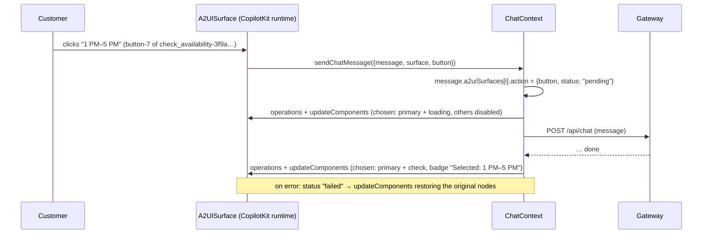
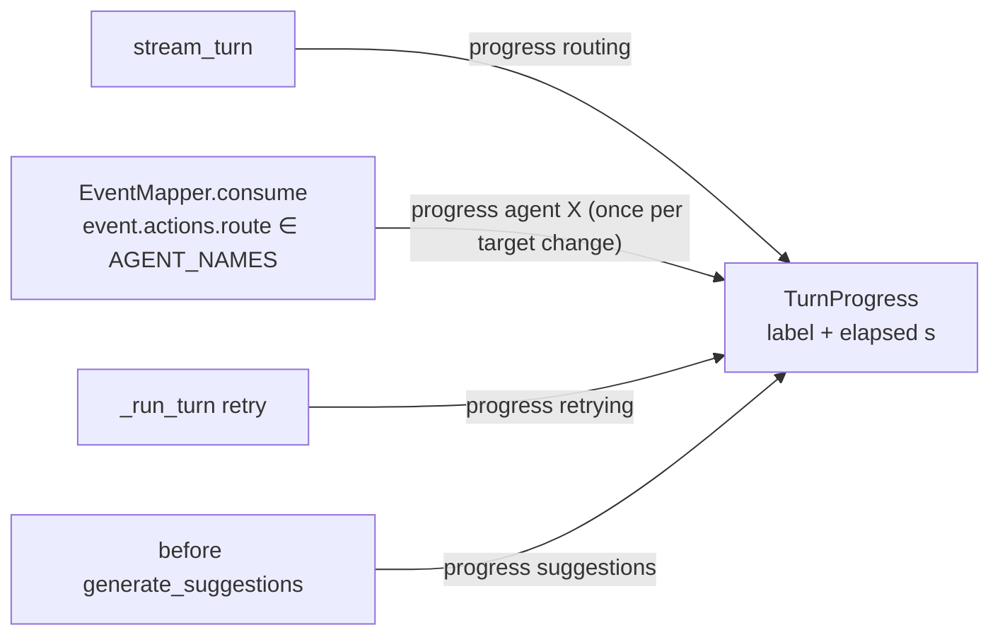
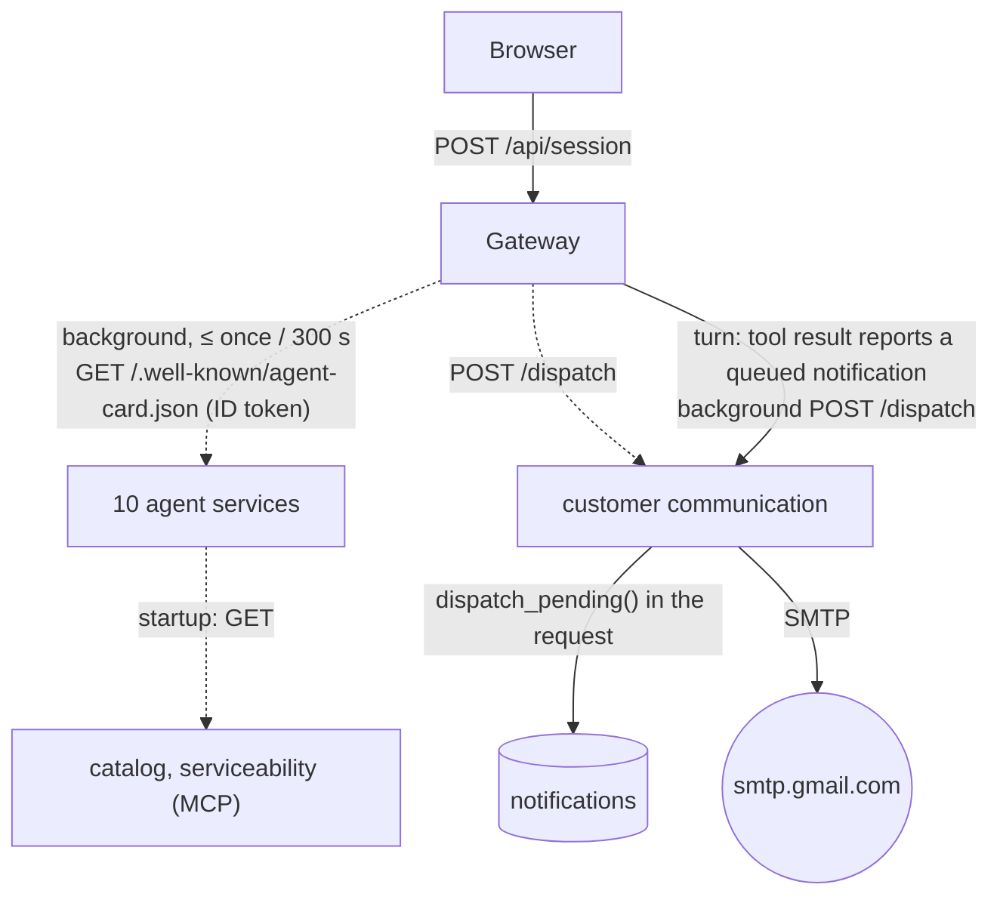

# Design: Turn Feedback and Email Dispatch

## 1. Completed card actions

- **Gateway** (`server/api/a2ui.py`): after `surface_id_for(tool, data)`, `build_surface` stamps every Button's `onClick.functionCall.args` with `surface` (the surface id) and `button` (the component id). The `message` arg is unchanged, so the router, transcript and evals are unaffected.
- **Catalog**: `salesUI.sendChatMessage` parameters become `{message: string, surface?: string, button?: string}`; `server/a2ui/catalog.json` is re-exported (`npm run export:a2ui-catalog`) and `test_a2ui.py` validates the args against it.
- **UI**: `src/a2ui/actedSurface.js` is a pure function `actedOperations(operations, action, kind)`. It returns `operations` plus one `updateComponents` operation (A2UI 1.0) for the surface:
  - chosen Button: `variant: "primary"`, `disabled: true`, `loading: true` while pending, `icon: "check"` when done;
  - every other Button: `variant: "default"`, `disabled: true`;
  - TextField / Select / CheckBox / RadioGroup / ChoicePicker / DateTimeInput: `disabled: true`;
  - root `Card`: one extra child, a `Badge` (`color: "success"`) "Saved" for `contact`, otherwise "Selected: <button label>"; while pending the badge reads "Sending…" (`color: "info"`).
  - For `status: "failed"` it appends an `updateComponents` with the original nodes (and the root without the badge), so the surface is clickable again.
- Why append instead of rewriting: `GenerativeUIRuntime.manager.ingest` (`@copilotkit/core` `generative-ui`) applies operations from the last applied index; a list that extends the previous one updates the surface in place and keeps the data model (the typed contact details). A list that does not extend it disposes and recreates the surface.
- `ChatContext`'s `sendChatMessage` handler finds the surface by id across messages, records `action` on it, and on `done`/`error` sets the status.
- **Clicks while a reply streams are queued, not refused.** A card can arrive in the middle of a turn: `add_new_company` shows the contact card, then the workflow hands off to serviceability and generates suggestions for another 10–15 s. The first cloud run (2026-11-27) showed the customer filling the card and clicking Save in that window; the handler refused the click silently, so the card looked untouched and nothing was sent. Now the click is recorded as `pending` at once (the card locks and shows "Sending…") and its message is kept in `queuedActionRef`; an effect on `isStreaming` sends it when the running turn ends (done or error). At most one click is held; a second click while one is queued is refused (its card is not locked, the first one is).

## 2. Turn progress

- `progress` is additive in the SSE contract (older clients ignore it). `EventMapper` already tracks `current_target` from `event.actions.route` (set by `route_intent`, `dispatch` and `handoff_policy` in `super_agent/workflow.py`); it now returns a `progress` payload when the target changes.
- UI: `TurnProgress.jsx` (Tailwind only) renders under the last message while `isStreaming`; `ChatContext` keeps `progress = {stage, agent, since}` and a 1 s ticker. Labels per agent come from `utils/agentLabels.js` (`progressLabel`). After 10 s on one stage it shows the cold-start hint.

## 3. Warm-up and email dispatch

- `server/api/background.py`:
  - `warm_services()`: `asyncio` task, `httpx.AsyncClient(timeout=90)`, `sales_common.auth.service_headers(url)` per request (ID token on Cloud Run, nothing locally); results only logged. Throttled per process by `WARMUP_INTERVAL_S`; disabled by `WARMUP_ENABLED=false`.
  - `request_dispatch()`: coalescing trigger. At most one `POST /dispatch` in flight; triggers that arrive meanwhile set a flag that causes exactly one follow-up call. Failures are logged; rows stay `pending` and are delivered by the next trigger or the service's loop.
  - Tasks are held in a module set so they are not garbage-collected.
- Cloud Run CPU: the gateway sends these requests while it is serving a request (session creation or a streaming turn), so they leave the gateway immediately. The target service does its work inside its own request, so it has CPU regardless of the gateway.
- `EventMapper.notification_queued` is set when a tool response reports a queued notification; `_run_turn` calls `request_dispatch()` once per turn, right after the event that set it, so dispatch overlaps the rest of the turn.
- Communication service: `create_a2a_app(..., extra_routes=[Route("/dispatch", dispatch_endpoint, methods=["POST"])])`; the handler runs `dispatch_pending()` in a thread (`asyncio.to_thread`) and returns `{"success": true, **counts}`. `FOR UPDATE SKIP LOCKED` already prevents double delivery between the endpoint and the loop. The service is private on Cloud Run (`--no-allow-unauthenticated`, invoker `csa-gateway`), like every agent.
- Agents: `sales_common.a2a_server` lifespan starts `warm_mcp_dependencies()`: for each environment variable ending in `_MCP_URL`, `GET <that MCP URL>` with `service_headers`, in the background, errors logged. The tool service answers with a 4xx (MCP needs a session), which is enough to start it.
- **Why not `/healthz`:** the first deploy used it and every warm-up returned 404 in 0.1–0.4 s: Cloud Run's front end reserves some paths ending in `z` (including `/healthz`) and answers them without reaching the container, so nothing was started. In-container probes and local runs are unaffected. Warm-up uses the agent card (`/.well-known/agent-card.json`, served by every A2A app without a database call) and the MCP endpoint instead.

## 4. Findings of the first cloud run

- **Delivery status in the panel.** The panel's notification entries came only from tool results, so they said "queued" forever. Now `EventMapper` collects the turn's `notification_id`s (all producer shapes; the four service-fulfillment producers now return the id). After suggestions and before `done`, `_run_turn` calls `background.notification_statuses(session_id, ids)`: it waits for the in-flight dispatch (`dispatch_idle(timeout=NOTIFY_STATUS_WAIT_S)`), runs `SELECT notification_id, status FROM notifications WHERE notification_id = ANY(%s)` (the gateway already writes this table in its maintenance job), returns the rows no longer `pending`, and keeps the rest per session in process memory for the next turn. Each becomes `activity_update` `{category: "notification", tool: "notification_status", data: {notification_id, status, status_update: true}}`; `ChatContext` updates the entry with that id. In the run the dispatch returned 1.5 s after the tool result, before the turn ended, so the wait is normally zero.
- **Closing cards of completed steps.** `ChatContext` watches `activity_update` events: `order` from `create_order` with an `order_id` closes open `cart`, `quote` and `contact` surfaces ("Order placed"); `scheduling` from `schedule_installation` with `success` closes open `scheduling` surfaces ("Installation booked"). Closing appends `{status: "closed", label}` to the surface's history; `actedOperations` renders it like `done` with no chosen Button (every Button `default` and disabled, inputs disabled, badge in `success`). Surfaces whose last entry is not `failed` are left alone.
- **Installation email time window.** `templates._installation_scheduled` formats `start_time`/`end_time` (`13:00` → `1 PM`) plus the window name (`morning`/`afternoon`/`all day`); the args already carried both.

## 5. Contact before the coverage check

The second cloud run showed the registration contact card and the coverage result in the same turn: the discovery → serviceability handoff fires as soon as `add_new_company` publishes a `customer_context` with a ZIP, so the customer is typing the contact while the coverage check is already running, and saves it after the coverage card. Now `ContextBridgePlugin` sets `registration_waiting_for_contact = True` when `add_new_company` succeeds and no contact email is on file (in the event's `customer_context` update or the session state). `evaluate_handoff` skips the discovery → serviceability rule while the flag is set and no `customer_context.contact.email` exists. The contact message ("My contact details: …") goes to discovery (`add_new_contact` publishes the contact); in that turn the rule fires with `clear_keys=("registration_waiting_for_contact",)`. If the customer asks for coverage directly instead, the router still sends that turn to `serviceability_agent`; the flag only stops the automatic handoff. This requirement is also modified by the open `returning-customer-resume` change; this delta carries its returning-customer exception, so archive `returning-customer-resume` first.

## 6. Provisioning after payment

The chain of deterministic handoffs ended at payment: in the third cloud run `process_payment` succeeded and nothing happened until the customer asked "What should I expect on my install day?", which the router sent to fulfillment (`provision_equipment`, `dispatch_technician`). `ContextBridgePlugin` now records `payment_completed_order` (the result's `order_id`) when `process_payment` succeeds; `evaluate_handoff` for `payment_agent` hands off to `service_fulfillment_agent` when that key is set and `order_context.installation.status` is `scheduled`, with the message "Payment is complete for order X. Provision the equipment and dispatch the technician for the scheduled installation now (provision_equipment, then dispatch_technician). Do not activate the service yet." Activation stays a later step (install day). The payment turn is normally a routed turn (hop 0), so the 2-hop limit is not reached. `dispatch_technician` already sets `provisioning_done`, so the same turn's suggestions use the `provisioning` playbook.

## Decisions

- **Not min-instances**: 12 always-on services would cost money while the demo is idle; warm-up gives most of the benefit at no idle cost (request-based billing).
- **Not Cloud Scheduler** for the outbox: adds infrastructure and up to a minute of delay; the gateway already knows the moment a notification is queued.
- **Client-side completion state** rather than gateway-side: the click happens in the browser, the gateway does not keep surfaces, and a failed turn must restore the card without another round trip.
